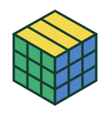

<div align="center">



# CUBEFLOW

**Understand every turn. Build a smoother solve.**

[简体中文](README.md) · **English**

[Play online](https://bobo8886.github.io/cube-lab/) · [Download source](https://github.com/bobo8886/cube-lab/archive/refs/heads/main.zip) · [MIT License](LICENSE)

</div>

An interactive CFOP learning lab with **41 F2L, 57 OLL and 21 PLL cases**, 3D playback and step-by-step explanations. No login is required.

## Choose your language

On your first visit, choose **简体中文** or **English** in the welcome dialog. Chinese is selected by default. Your choice stays in this browser. Use the language button in the header to switch anytime without losing playback position, learned cases or practice times.

Navigation, recognition tips, explanations, case names, move directions and timer controls are available in both languages. Standard cube notation stays the same.

## Learn in motion

| Feature | What you can do |
| --- | --- |
| Interactive 3D | Rotate the view, zoom, and watch real layer turns |
| Step-by-step playback | Pause, rewind, change speed, click a move or scrub the timeline |
| Full CFOP library | Search 119 cases by name, number or move sequence |
| Beginner library | Start with 19 teaching examples, including 2-look OLL / PLL |
| Recognition | Compare six-face diagrams and follow the target pieces |
| Practice | Mark learned cases and save times locally |
| Responsive design | Use light or dark mode on desktop and mobile |

The 19 beginner examples overlap with the full library. F2L numbering follows Cubeathon and may differ from other tutorials. In a real solve, OLL only orients the last layer; PLL handles permutation.

## Run locally

With Python 3 installed:

```sh
git clone https://github.com/bobo8886/cube-lab.git
cd cube-lab
python -m http.server 4173 --directory dist
```

Open http://localhost:4173. No npm installation or build is needed. Use an HTTP server rather than double-clicking HTML because the site uses ES modules.

## Controls and data

Drag to rotate; scroll to zoom. Use the playback buttons or Space and arrow keys while the player is visible and focus is outside a control. Click a move to seek to the state before that move.

The starting grip is white down, yellow up, green front and red right. Diagrams show the case’s starting state. Camera rotation changes your view, not the move notation.

Language, theme, learned cases and times stay in the current browser. There is no cloud sync. Clearing site data removes these records.

## Development

```sh
node verify.mjs
node verify-i18n.mjs
```

GitHub Actions checks the case library and language coverage before deploying `dist/` to GitHub Pages. See [development notes](docs/DEVELOPMENT.md) for the project structure.

## Credits and license

Original code, documentation and vector branding use the [MIT License](LICENSE), allowing personal and commercial use, modification and redistribution with the copyright and license notices retained.

Three.js and OrbitControls retain their own MIT notices. Teaching references include [J Perm](https://jperm.net/3x3/cfop), [Cubeathon F2L](https://cubeathon.com/algorithms/f2l) and [CubeSkills](https://cubeskills.com/). External tutorials retain their respective rights; see [third-party notices](THIRD_PARTY_NOTICES.md).
