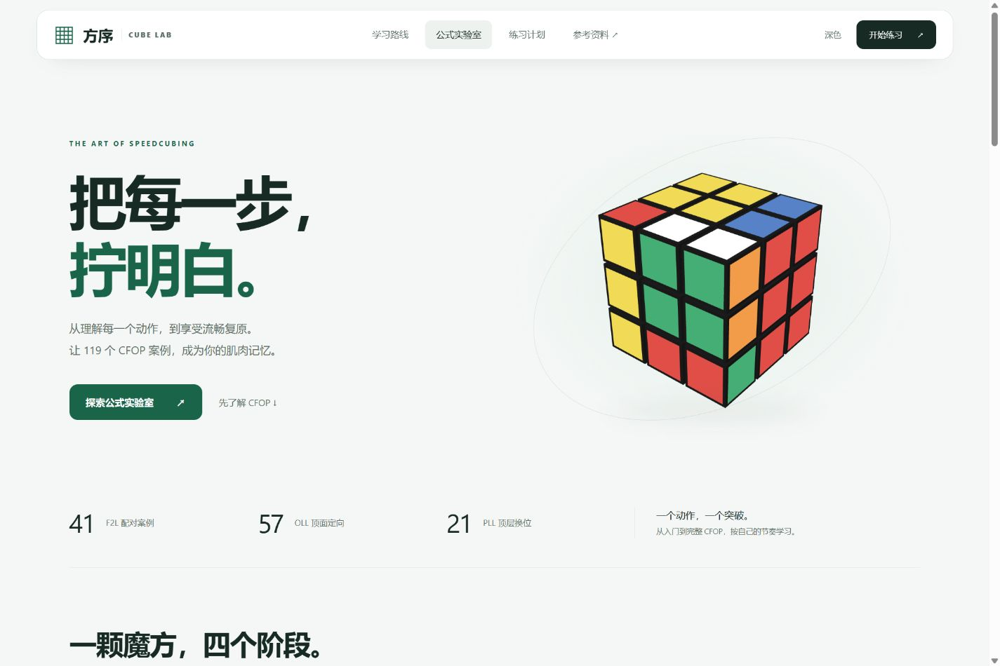

<div align="center">

<picture>
  <source media="(prefers-color-scheme: dark)" srcset="docs/images/cube-lab-banner-dark.svg">
  
</picture>

**从看懂公式，到流畅复原。**

一个可以旋转、播放、逐步拆解的中文 CFOP 速拧学习实验室。

[](#-完整的-cfop-学习路线)
[](docs/DEVELOPMENT.md)
[](LICENSE)

[](https://cube-lab-cfop-20261117.lustrouswatermelon.chatgpt.site)
[](https://github.com/bobo8886/cube-lab/archive/refs/heads/main.zip)
[](docs/USER_GUIDE.md)

[功能亮点](#-让公式变成看得见的动作) · [快速开始](#-快速开始) · [开发与核验](docs/DEVELOPMENT.md) · [问题反馈](https://github.com/bobo8886/cube-lab/issues)

</div>

> **在线试玩**：当前演示站需使用有访问权限的 ChatGPT 账号登录。也可以下载源码在本地运行。仓库访问权限与软件许可证是两回事。



## ✨ 让公式变成看得见的动作

| 功能 | 你可以这样学 |
| --- | --- |
| 🧊 **真实 3D 魔方** | 拖动观察六面，播放真实分层旋转；统一白底黄顶、绿前红右的初始握持 |
| 🎬 **逐步拆解** | 暂停、回退、调速，点击公式中的动作定位，拖动进度条查看任意一步 |
| 📚 **完整案例库** | 41 个 F2L、57 个 OLL、21 个 PLL，支持分类和按名称、编号、公式搜索 |
| 🔍 **识别与解析** | 对照初始六面展开图，理解案例特征和每一步转动方向 |
| ⏱️ **练习与记录** | 标记已掌握案例、练习计时，记录保存在当前浏览器本地 |
| 🌗 **清晰又轻快** | 浅色 / 深色主题，桌面三栏与手机布局；模型复用、按需绘制，无运行时 CDN 依赖 |

## 🧩 完整的 CFOP 学习路线

| 阶段 | 学习目标 | 内容 |
| --- | --- | --- |
| **C · Cross** | 在底面建立十字，并对齐侧面中心 | 十字观察与入门示例 |
| **F · F2L** | 将角块与棱块配对，插入前两层 | **41** 个完整案例 |
| **O · OLL** | 统一顶层贴纸朝向 | **57** 个完整案例 |
| **P · PLL** | 调整顶层块的位置，完成复原 | **21** 个完整案例 |

完整库共 **119 个非复原案例**；另有 **19 个入门教学示例**，与完整库存在重叠，不是额外 19 个独立高级公式。刚开始学习时，可先选入门模式，再逐步切换到完整库。

## 🚀 快速开始

### 在线体验

打开 **[方序 · 在线试玩 ↗](https://cube-lab-cfop-20261117.lustrouswatermelon.chatgpt.site)**，选择阶段与案例后点击播放。当前站点需账号访问权限。

### 本地运行

安装 Python 3 后，在终端执行：

```sh
git clone https://github.com/bobo8886/cube-lab.git
cd cube-lab
python -m http.server 4173 --directory dist
```

然后打开 **http://localhost:4173**。也可下载上方源码 ZIP，解压后在项目目录运行最后一条命令。

无需 npm 安装或构建。页面使用 ES 模块，请通过 HTTP 服务访问，不要直接双击 HTML。首次获取私有仓库源码需要 GitHub 访问权限；下载后运行不依赖 GitHub 登录。

## 🎛️ 常用操作

| 操作 | 方法 |
| --- | --- |
| 观察 / 缩放魔方 | 鼠标或触屏拖动 / 桌面滚轮缩放 |
| 播放 / 暂停 | 点击播放按钮，或在演示区可见且焦点不在控件内时按空格 |
| 前进 / 回退 | 点击单步按钮，或使用左右方向键 |
| 定位某一步 | 点击公式动作，或拖动公式进度条 |
| 切换案例 | 左侧列表；手机使用案例选择器 |
| 保存学习进度 | 点击“标记已掌握”，自动保存在当前浏览器 |

更详细的操作与常见问题见 **[使用指南](docs/USER_GUIDE.md)**。

## 🛠️ 开发与验证

```sh
node verify.mjs
```

校验覆盖转动与逆操作、54 张贴纸完整性、所有案例公式复原、OLL / PLL 保持前两层，以及完整库的状态唯一性。当前 **119 个完整案例与 19 个入门示例通过校验**。

<details>
<summary><strong>查看项目结构与技术说明</strong></summary>

```text
dist/                  可直接部署的静态网站
  app.js               Three.js 动画与页面交互
  model.js             魔方状态与转动引擎
  catalog.js           完整公式库
  lesson.js            案例识别与解析
  vendor/              Three.js 与 OrbitControls
research/              整理后的案例数据与核验脚本
docs/                  使用指南、开发说明与展示图片
build-catalog.mjs      从案例数据生成公式库
verify.mjs             状态、公式与唯一性校验
LICENSE                MIT 许可证
THIRD_PARTY_NOTICES.md  第三方依赖与资料来源
```

完整说明见 [开发与核验](docs/DEVELOPMENT.md)。静态托管时将网站根目录指向 `dist/`。

</details>

## 📖 资料与致谢

教学参考 [J Perm CFOP](https://jperm.net/3x3/cfop)、[J Perm OLL](https://jperm.net/algs/oll)、[J Perm PLL](https://jperm.net/algs/pll)、[Cubeathon F2L](https://cubeathon.com/algorithms/f2l) 和 [CubeSkills](https://cubeskills.com/)。3D 展示由 [Three.js](https://threejs.org/) 驱动。

F2L 编号采用 Cubeathon 顺序，不是跨教程统一编号。OLL 演示最终复原整颗魔方，但实际 OLL 阶段只保证顶面朝向，仍需 PLL。完整来源与许可范围见 [第三方说明](THIRD_PARTY_NOTICES.md)。

## 📄 许可证

原创代码、文档与项目矢量标识采用 **[MIT License](LICENSE)**：允许个人及商业使用、修改和分发，需保留版权与许可声明。

Three.js / OrbitControls 遵循其原有 MIT 许可；外部教程、文章、视频及其他第三方内容不因本项目的许可而改变权利归属。

---

<div align="center">

**方序 · CUBE LAB** · 由 [bobo8886](https://github.com/bobo8886) 维护<br>
把公式看明白，把复原练流畅。

</div>
